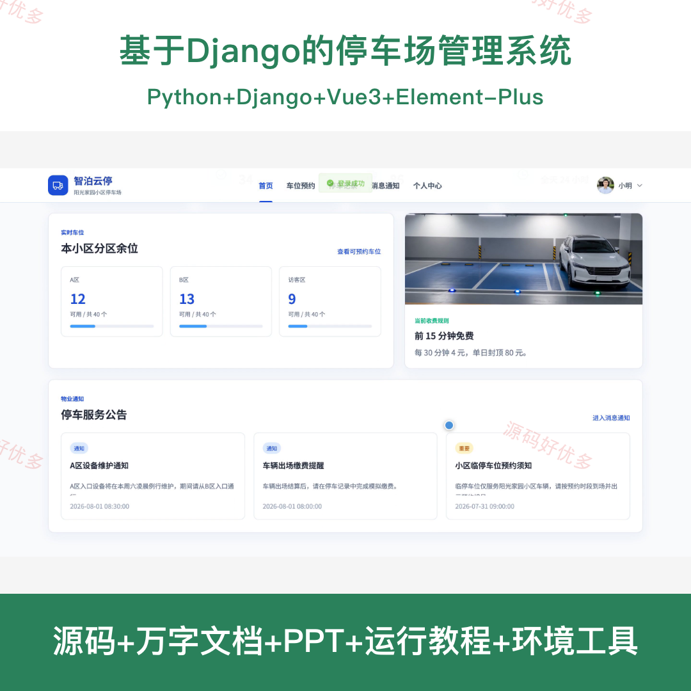
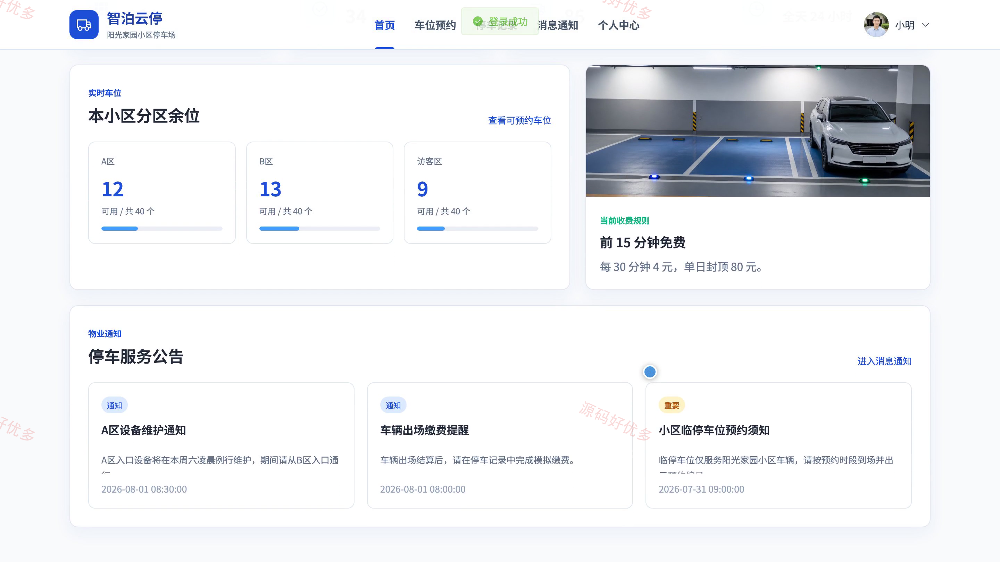
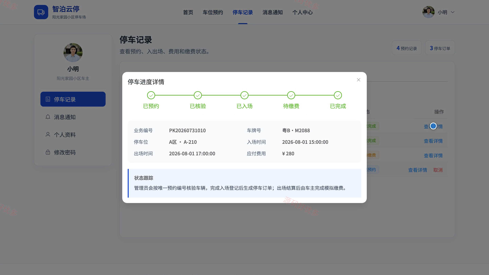
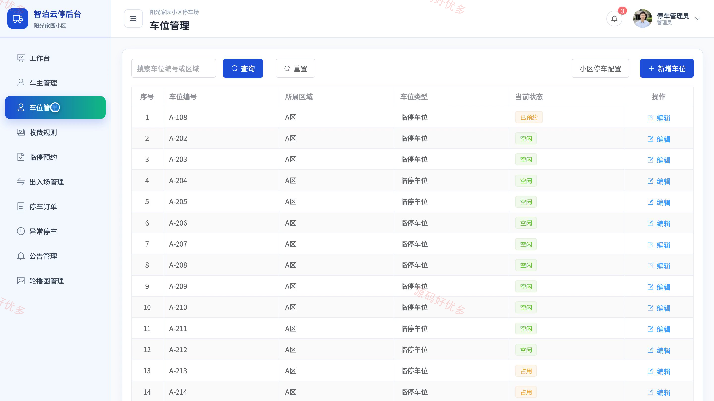
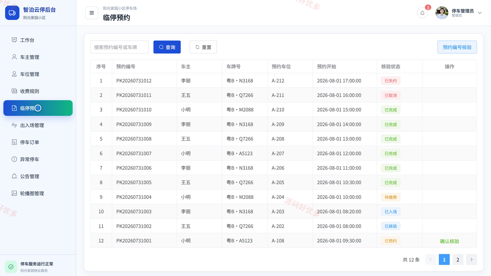
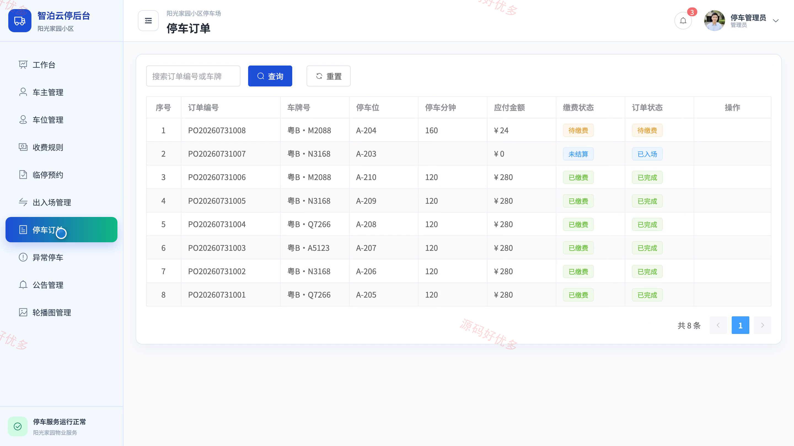
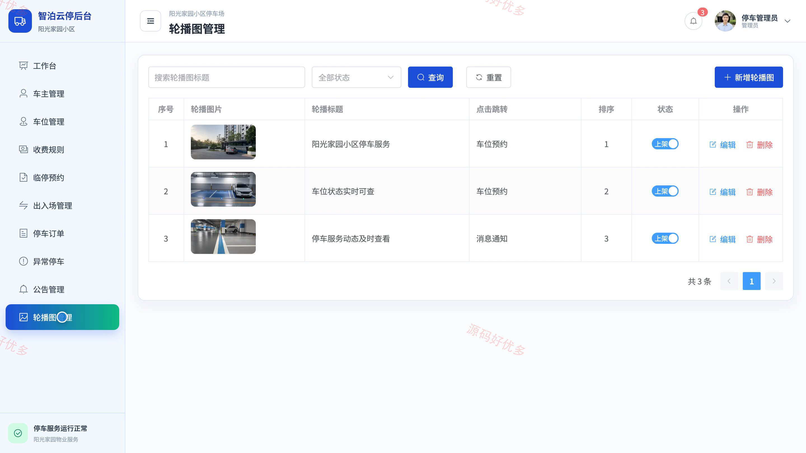

# bs013C
bs013C基于Django的停车场管理系统源码 Python Django Vue3 前后分离
## 源码问题查看主页咨询

### 一、关键词
智慧停车、小区停车、车位预约、车辆出入、停车缴费

### 二、作品包含
源码+数据库+万字设计文档+PPT+全套环境和工具资源+本地部署教程

### 三、项目技术
前端技术： Html、Css、Js、Vue3.4、Element-Plus
后端技术：Python、Django

### 四、运行环境要求
开发工具：PyCharm + VSCODE

数据库：MySQL5.7+（共12张表）

数据库管理工具：Navicat10以上版本

环境配置软件： Python3+

前端Nodejs：16+

浏览器：谷歌浏览器

### 五、项目介绍
项目编号：bs013C

停车场管理系统面向小区车主与停车管理员，提供车位查询与预约、车辆资料维护、车辆出入登记、停车订单结算、模拟缴费、异常停车处理和运营数据统计，支持从预约入场到出场缴费的完整停车流程。

角色：车主、管理员

车主功能：注册登录与账户安全、车辆资料维护、可用车位查询与预约、预约记录与取消、停车订单与进度查看、停车费用模拟缴付、消息通知查看、个人资料与密码维护。

管理员功能：停车运营数据统计、车主账号管理、停车场与车位管理、收费规则管理、预约编号核验、车辆入场登记与出场结算、停车订单与异常停车处理、公告与轮播图管理。

### 六、运行截图

